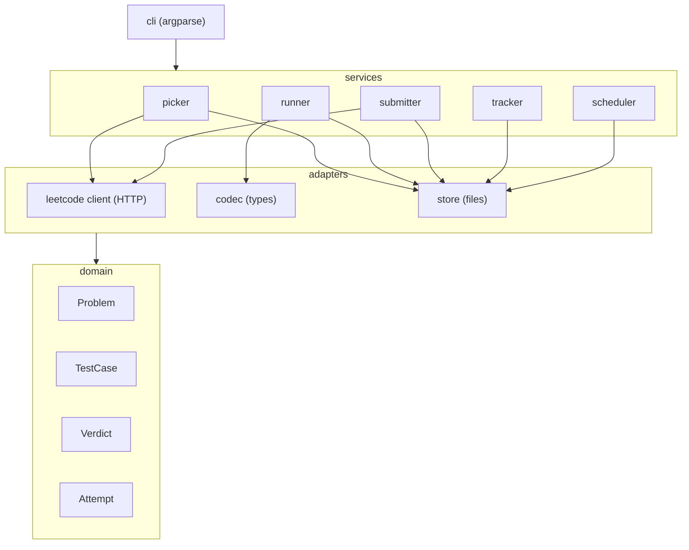

# Python DSA Practice Framework, Plan

Status: approved 2026-11-25. Phase 0 next.

## 1. Goal

One Python command, `dsa`, runs the full practice loop from the terminal in `python/`:

1. Fetch a problem and its test cases from LeetCode.
2. Run the cases locally with a report in LeetCode's format.
3. Submit to LeetCode for the final verdict.
4. Log each attempt and schedule re-solves.

Tooling comes first (phases 0 to 3). The practice method follows (phases 4 and 5).

## 2. Approaches

| Approach                       | Trade-off                                                                                                                                                     | Decision |
| ------------------------------ | ------------------------------------------------------------------------------------------------------------------------------------------------------------- | -------- |
| Adopt leetgo (Go CLI)          | Least work and maintained by others. A Go binary, so it cannot hold the solve log and review schedule. Fixed file layout. Local report format not documented. | Rejected |
| Own Python framework           | Full control of layout, report and method layer. We maintain the LeetCode client.                                                                             | Chosen   |
| leetgo plus own report wrapper | Two tools to keep in sync. Only worth it if leetgo's report were weak.                                                                                        | Rejected |

## 3. Commands

```
dsa pick 217        fetch problem, create stub and test cases
dsa test 217        run cases locally, LeetCode-style report
dsa run 217         run on LeetCode's judge (gets expected output)
dsa submit 217      final submit, show verdict, runtime, memory
dsa start 217       start the timer for a re-solve
dsa review          problems due for re-solve today
dsa stats           solved count by topic and difficulty
```

## 4. Architecture



* Each layer calls only the layer below it.
* `Verdict` is a closed set: Accepted, Wrong Answer, Runtime Error, Time Limit Exceeded.
* The LeetCode client is the only code that knows LeetCode URLs and JSON shapes. An API change breaks only this layer.
* Python standard library only (`urllib`, `json`, `argparse`, `html.parser`). pytest is the only dependency, used to test the framework itself.
* Framework tests live in `python/tests/`. Each phase is test first.

## 5. Per-Problem Layout

```
python/leetcode/easy/__1_217_contains_duplicate/
  solution.py
  cases.txt
  problem.md
  meta.json
```

The folder name keeps the Java convention: `__{n}_{id}_{snake_name}`, where `n` is the next number in the difficulty folder.

### 5.1 solution.py

LeetCode starter code with a header. `dsa submit` sends only the lines between the `@lc` markers, because LeetCode already defines `List`, `ListNode` and `TreeNode`.

```python
"""217. Contains Duplicate (Easy)

Time:  O(?)
Space: O(?)
"""

# @lc code=start
class Solution:
    def containsDuplicate(self, nums: list[int]) -> bool:
        pass
# @lc code=end
```

* `Time` and `Space` apply the mastery plan rule "prove the bound". `dsa stats` flags solutions that still show `O(?)`.
* Linked list and tree problems also get `from dsa.nodes import ListNode, TreeNode` above the start marker.

### 5.2 cases.txt

LeetCode raw format. Cases are blocks separated by a blank line. Each block has one line per parameter, then one line for the expected output. A block with no expected line gets it filled in by `dsa run`.

```
[1,2,3,1]
true

[1,2,3,4]
false

[1,1,1,3,3,4,3,2,4,2]
true

[5,5]
```

The last block is a custom case pasted from LeetCode's test box, with no expected line yet.

Design problems (for example 155 Min Stack) follow the same rule with two input lines:

```
["MinStack","push","push","push","getMin","pop","top","getMin"]
[[],[-2],[0],[-3],[],[],[],[]]
[null,null,null,null,-3,null,0,-2]
```

### 5.3 problem.md

Description converted from LeetCode HTML for offline reading. The `Notes` section is for your own approach notes.

```markdown
# 217. Contains Duplicate

Easy · Array, Hash Table, Sorting · https://leetcode.com/problems/contains-duplicate/

Given an integer array `nums`, return `true` if any value appears at least
twice in the array, and return `false` if every element is distinct.

## Example 1
Input: nums = [1,2,3,1]
Output: true

## Constraints
* 1 <= nums.length <= 10^5
* -10^9 <= nums[i] <= 10^9

## Notes
```

### 5.4 meta.json

Generated, never edited by hand. The runner needs the types to decode `cases.txt`. The submitter needs `question_id`. JSON, because the standard library cannot read YAML front matter.

```json
{
  "id": 217,
  "question_id": "217",
  "slug": "contains-duplicate",
  "difficulty": "Easy",
  "topics": ["Array", "Hash Table", "Sorting"],
  "signature": {
    "name": "containsDuplicate",
    "params": [{"name": "nums", "type": "integer[]"}],
    "return": {"type": "boolean"}
  }
}
```

`signature` is LeetCode's `metaData`, copied as is.

### 5.5 Shared Files

`python/log.jsonl` (committed). One line per attempt:

```json
{"id": 217, "at": "2026-11-25T10:42:00", "action": "submit", "verdict": "Accepted", "seconds": 540, "help": "none", "runtime_ms": 12, "memory_mb": 31.2}
```

* `seconds` counts from `dsa pick`, or from `dsa start` for a re-solve.
* `help` is one of `none`, `hint`, `solution`. Set with `dsa submit 217 --help hint`.

`python/.env` (gitignored). Cookies for `run` and `submit`:

```
LEETCODE_SESSION=...
LEETCODE_CSRFTOKEN=...
LEETCODE_CFCLEARANCE=...
```

## 6. Where Test Cases Come From

| Source                                  | Gives                                                                    | When         |
| --------------------------------------- | ------------------------------------------------------------------------ | ------------ |
| GraphQL `exampleTestcases`              | Example inputs                                                           | `dsa pick`   |
| GraphQL `content` HTML, `Output:` lines | Expected outputs for the examples                                        | `dsa pick`   |
| LeetCode judge (remote run)             | Expected output for any input without one                                | `dsa run`    |
| You                                     | Custom inputs pasted into `cases.txt`                                    | Any time     |
| Failed submit                           | The failing hidden case and its expected output, appended to `cases.txt` | `dsa submit` |

LeetCode never exposes the full hidden test set. The local set grows from your own failed submits.

## 7. Verified Facts

Checked 2026-11-25 with a public request (no login) to `https://leetcode.com/graphql`, query `question(titleSlug: "contains-duplicate")`:

* `questionId` is `"217"`.
* `exampleTestcases` is `"[1,2,3,1]\n[1,2,3,4]\n[1,1,1,3,3,4,3,2,4,2]"`: all example inputs joined by `\n`. For n parameters, every n lines form one case.
* `metaData` is a JSON string inside the JSON, with `\r\n` line endings. It must be decoded a second time. Its shape matches `signature` in section 5.4.
* No expected outputs in these fields.

Phase 0 public probe, 2026-11-25, problems 217, 1, 206, 104, 155, 88, 3110. All matched:

* Slug lookup works: `questionList(filters: {searchKeywords: "<id>"})`, then pick the row whose `questionFrontendId` equals the id.
* Expected outputs parse from `content` for both HTML layouts (old `<pre>` blocks and the newer `<p>` example blocks). Count matched the inputs every time.
* `questionId` can differ from the problem number: 3110 has `questionId` 3379. `meta.json` must keep both.
* The python3 starter uses built-in generics (`list[int]`), so `solution.py` needs no `typing` import.
* `ListNode` and `TreeNode` appear as type names in `params` and `return`. The starter code holds their definitions as comments.
* In-place problems have `return.type` `void` and `"output": {"paramindex": 0}`, the index of the argument to compare (88).
* Design problems have `classname`, `constructor`, `methods` (each with typed `params` and `return`) and `"systemdesign": true`, and take two input lines per case (155).
* Unknown: the meaning of `"manual": false` on 1 (Two Sum). Two Sum accepts either order, so it is not an any-order flag. Any-order answers still need a compare override for each problem.

## 8. Phases

0. **Trial (throwaway, scratchpad, no repo changes).** A script with your cookies confirms:
   * the `content` field and parsing of `Output:` lines
   * looking up the slug from the id
   * remote run, then polling for the result
   * submit, then polling for verdict, runtime, memory and the failing case

   Done when all four return real data.
1. **`dsa pick`.** Fetch the problem and write the four files. Migrate the staged pytest scaffold and 217 to the folder layout.
2. **`dsa test`.** Codec for the LeetCode types: integers, strings, booleans, arrays, nested arrays, `ListNode`, `TreeNode` (`[1,null,2]`) and grids. Run each case with a timeout and print the report:

   ```
   Case 2: Wrong Answer
   Input     nums = [1,2,3,1]
   Output    false
   Expected  true
   ```

3. **`dsa run` and `dsa submit`.** Send to LeetCode's judge, poll for the result, print the verdict in the same format, and append failing cases to `cases.txt`.
4. **Tracker.** `test` and `submit` log each attempt to `log.jsonl`. `dsa start` starts the timer for a re-solve.
5. **Review and stats.** Re-solve intervals of 1, 3, 7, 14 and 30 days after each solve, which reset on a failed re-solve. Stats by LeetCode topic and difficulty, linked to the phases of the DSA Mastery Plan (vault note `20-areas/personal/dsa-mastery-plan.md`).
6. **Docs.** Rewrite `python/README.md` and add a Python section to `.claude/CLAUDE.md`.

## 9. Hard Cases for the Runner

* Design problems (155 Min Stack): the input is a list of operations and a list of arguments, and the output is a list with one result per operation.
* In-place problems (88 Merge Sorted Array): the method returns `None`, so the runner compares the changed argument.
* Any-order answers: a compare override for each problem.

## 10. Risks

* LeetCode's API is unofficial and can change without notice. Only the client layer breaks.
* Cookies expire, and leetcode.com's Cloudflare check needs `cf_clearance`. The tool reports an expired login clearly instead of failing silently.
* The remote run and submit endpoints are not verified yet. Phase 0 covers them.
